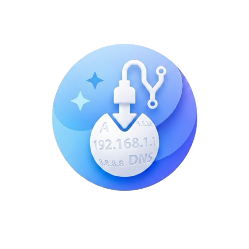
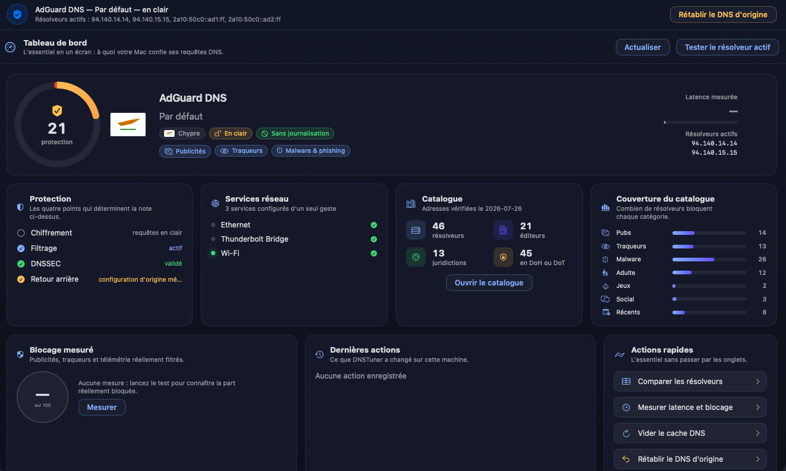

<div align="center">



# DNSTuner

**Le sélecteur de DNS système pour votre Mac. En clair ou chiffré, en un clic, entièrement réversible.**

*The system-wide DNS switcher for your Mac. Plain or encrypted, one click, fully reversible.*


<br/>



<br/><br/>

### 🇫🇷 [Version française](#-français) &nbsp;&nbsp;·&nbsp;&nbsp; 🇬🇧 [English version](#-english)

</div>

<br/>

---

# 🇫🇷 Français

## Présentation

DNSTuner bascule la résolution DNS de tout votre Mac vers un résolveur public
choisi dans un catalogue de 46 entrées : AdGuard, Cloudflare, Quad9, OpenDNS,
Mullvad, DNS4EU, Control D, CleanBrowsing, NextDNS, dns0.eu, CZ.NIC, FDN, CIRA,
Google et d'autres. La bascule se fait en clair ou en chiffré, par DoH ou DoT.

L'application dit ensuite honnêtement ce que chaque résolveur bloque, en croisant
ce que le fournisseur annonce avec ce qu'elle mesure réellement sur votre machine.

Rien ne se fait à votre insu et tout est réversible. Les DNS d'origine de chaque
service réseau sont mémorisés avant la première écriture, puis rétablis à
l'identique d'un seul clic. DNSTuner n'emploie que des outils documentés par Apple
(`networksetup`, `scutil`, `dscacheutil`, `profiles`). Aucun fichier système n'est
modifié, aucun démon n'est installé, aucun privilège permanent n'est conservé.

## Fonctionnalités

### Choisir et appliquer

| Module | Ce qu'il apporte |
|---|---|
| **Tableau de bord** | Une note de protection, le résolveur actif avec son drapeau de juridiction, la latence mesurée, l'état des services réseau, les compteurs du catalogue, la couverture par catégorie et les dernières actions, le tout en un seul écran. |
| **Fournisseurs** | Catalogue de 46 résolveurs groupés par éditeur, recherche par nom ou par adresse, filtres par catégorie bloquée, et favoris. L'application écrit sur tous les services réseau actifs en une seule demande de mot de passe. |
| **DNS chiffré** | DoH et DoT par profil de configuration `com.apple.dnsSettings.managed`, avec une installation guidée en deux clics et une désinstallation déclenchée directement depuis l'application. |
| **Personnalisé** | Résolveur hors catalogue, défini par ses adresses IPv4 et IPv6 et son URL DoH, avec validation stricte de chaque adresse avant écriture. |

### Comparer et mesurer

| Module | Ce qu'il apporte |
|---|---|
| **Comparatif** | Matrice « que bloque quoi » sur sept catégories : publicités, traqueurs, malware, contenu adulte, jeux d'argent, réseaux sociaux et domaines récemment enregistrés. L'annonce du fournisseur et la mesure réelle sont superposées. |
| **Note de blocage** | Un panel de 40 domaines témoins (régies publicitaires, traqueurs, télémétrie, widgets sociaux, malware, contenu adulte) interrogés un par un, avec une note sur 100 et un niveau de protection. Chaque domaine est nommé, avec sa fonction et la réponse obtenue : vous voyez exactement ce qui passe et ce qui ne passe pas. |
| **Test** | Latence médiane et blocage effectif de chaque résolveur, sans rien modifier sur la machine. L'interrogation passe par `dig` en clair, ou par DoH filaire conforme à la RFC 8484 pour les fournisseurs sans adresse publique, comme Mullvad. |
| **Diagnostic** | Dix tests sur la configuration réellement active : chiffrement, résolveur sortant, transmission de votre sous-réseau (ECS), validation DNSSEC, détournement des réponses NXDOMAIN, protection anti-rebinding, et blocage effectif des publicités, des traqueurs, du malware et du contenu adulte. Chaque test affiche sa mesure brute. |

### Contrôler et revenir en arrière

| Module | Ce qu'il apporte |
|---|---|
| **État** | Ce que le système résout vraiment (`scutil --dns`), le DNS déclaré service par service, l'état du chiffrement et la liste des profils DNSTuner installés. |
| **Retour arrière** | Les DNS d'origine, mémorisés avant la première écriture, sont rétablis à l'identique. Le bouton « Rétablir » retire également le profil chiffré, qui primerait sinon sur la configuration restaurée. |
| **Journal** | Chaque action sur la configuration, avec son résultat. Aucune donnée personnelle n'y figure : uniquement des noms de services réseau et des adresses de résolveurs publics. |
| **Réglages** | Langue, résolveur personnalisé, et la section « Ce qu'un DNS filtrant ne peut pas faire ». |

## Ce que macOS permet et ce qu'il refuse

Le DNS chiffré à l'échelle du système n'a que deux portes d'entrée sur macOS, et
une seule est ouverte à une application signée en ad hoc.

**`NEDNSSettingsManager`**, du framework Network Extension, exige l'entitlement
`com.apple.developer.networking.networkextension` avec la valeur `dns-settings`,
donc un profil de provisioning délivré par un compte développeur Apple payant.
Cette voie est inaccessible ici.

**Le profil de configuration** `com.apple.dnsSettings.managed`, en portée système,
est la voie retenue. Une configuration DNS chiffrée passe par le même sous-système
que les VPN, lequel n'existe qu'au niveau de la machine : en portée utilisateur,
macOS refuse le profil.

Cette voie comporte une asymétrie qu'il faut connaître. `profiles install` est
déprécié depuis macOS 11, Apple renvoyant vers le volet Profils des Réglages
Système. L'installation passe donc obligatoirement par votre validation dans
**Réglages Système › Général › Gestion des appareils**. En revanche,
`profiles remove -identifier` reste scriptable, si bien que le bouton
« Désactiver » de l'application fonctionne pleinement.

### Deux pièges du DNS sur macOS

**Le DNS n'est pas global, il est défini par service réseau.** Ne régler que le
Wi-Fi laisse l'Ethernet et le Thunderbolt Bridge sur le DNS du routeur. DNSTuner
écrit sur tous les services activés en concaténant les commandes dans un script
unique, ce qui donne une seule demande de mot de passe au lieu d'une par interface.

**`networksetup -getdnsservers` ment par omission.** Un service configuré en DHCP
y apparaît vide alors qu'il résout parfaitement. La vérité terrain est
`scutil --dns`, que l'onglet **État** affiche en premier.

### Mécanismes employés

| Capacité | Mécanisme | Privilèges |
|---|---|---|
| Définir le DNS d'un service | `networksetup -setdnsservers <service> <adresses>` | administrateur |
| Revenir au DNS du routeur | `networksetup -setdnsservers <service> Empty` | administrateur |
| Lire le DNS déclaré | `networksetup -getdnsservers <service>` | aucun |
| Lister services et interfaces | `networksetup -listnetworkserviceorder` | aucun |
| Lire le DNS réellement utilisé | `scutil --dns` | aucun |
| Vider le cache de résolution | `dscacheutil -flushcache` puis `killall -HUP mDNSResponder` | administrateur |
| Détecter les profils installés | `profiles status -type configuration` | aucun |
| Supprimer un profil | `profiles remove -identifier <id>` | administrateur |

## Ce qui est bloquable et ce qui ne l'est pas

Le blocage DNS agit sur un nom de domaine entier : le résolveur répond `NXDOMAIN`
ou renvoie une adresse puits, et rien ne se connecte. Selon le fournisseur, cela
couvre les publicités, les traqueurs, le malware et le hameçonnage, le contenu
adulte, les jeux d'argent, les réseaux sociaux et les domaines fraîchement
enregistrés.

Voici en revanche ce qu'un DNS filtrant ne peut pas faire. L'application le
rappelle dans ses Réglages, pas seulement dans ce document.

1. Les publicités servies depuis le domaine du contenu lui-même, sur YouTube,
   Instagram ou Twitch, ne peuvent pas être bloquées sans casser le service entier.
2. Le DNS ne voit qu'un nom de domaine. Jamais le chemin d'une URL, jamais le
   contenu d'une page.
3. Chrome et Firefox peuvent activer leur propre DoH et court-circuiter le
   résolveur du système.
4. Un VPN actif, ou une application dont le DNS est codé en dur, échappe au réglage.
5. Un filtrage strict provoque des faux positifs. C'est la raison pour laquelle le
   catalogue contient plusieurs résolveurs sans filtrage, utiles au diagnostic.

### Écart assumé avec AdGuard Home

| | AdGuard Home | DNSTuner |
|---|---|---|
| Résolveur local | oui | non |
| Listes de filtrage personnalisables | oui | non, celles du fournisseur |
| Règles par domaine, journal des requêtes | oui | non |
| Démon root à maintenir | oui | **non** |
| Réversibilité en un clic | partielle | **totale** |

DNSTuner choisit délibérément le second modèle : aucun processus privilégié
permanent, aucune liste à tenir à jour, et un retour arrière complet garanti.

## Sécurité et confidentialité

DNSTuner n'emploie que des outils documentés par Apple : `networksetup`, `scutil`,
`dscacheutil` et `profiles`. Aucun fichier système n'est modifié, aucun démon
n'est installé, aucun privilège permanent n'est conservé.

Les suppressions de profils sont bornées au préfixe `fr.bodyroro.dnstuner.` :
un profil MDM ou tiers ne peut pas être touché, même par erreur.

Toute adresse saisie à la main est validée par `IPAddress.isValid` avant écriture.
Une adresse invalide transmise à `networksetup` couperait la résolution DNS de la
machine entière.

Le sous-réseau révélé par le test ECS est une donnée personnelle. Il s'affiche à
l'écran et n'est jamais écrit dans le journal.

Le catalogue porte un champ `verifiedOn`. Les entrées dont les adresses n'ont pas
pu être relues sur la documentation officielle du fournisseur sont signalées dans
l'interface par un avertissement explicite, et ne sont jamais présentées comme
vérifiées.

## Installation

DNSTuner se compile depuis les sources. Il n'existe pas d'archive à télécharger :
le code est ici, et vous produisez vous-même le binaire que vous exécutez. C'est
le seul moyen d'avoir la certitude que l'application fait exactement ce que le
code décrit.

**Prérequis :** macOS 26 ou 27, un Mac Apple Silicon (M1 à M4), et les *Command
Line Tools* d'Apple. Aucune dépendance externe. Xcode n'est pas nécessaire.

```bash
xcode-select --install                              # une seule fois
git clone https://github.com/Bodyroro/DNSTuner.git
cd DNSTuner
./build.sh
```

`build.sh` compile l'ensemble des sources en ciblant macOS 26.0, ce qui garantit
la compatibilité avec macOS 26 comme avec macOS 27. Le script génère ensuite
l'icône à partir de `logo.png`, signe le bundle en ad hoc, puis lance
l'application.

Pour installer DNSTuner durablement, glissez **DNSTuner.app** dans votre dossier
**Applications**.

> Le bundle est signé en ad hoc et n'est pas notarisé. Il reste parfaitement
> valide sur votre machine puisque vous venez de le produire. Aucune manipulation
> de Gatekeeper n'est requise : cette contrainte ne concerne que les archives
> téléchargées depuis Internet.

### Compilation manuelle

```bash
swiftc -O -parse-as-library -target arm64-apple-macos26.0 \
  Sources/**/*.swift Sources/*.swift \
  -o DNSTuner.app/Contents/MacOS/DNSTuner
codesign --force --sign - DNSTuner.app
open DNSTuner.app
```

## Architecture du projet

```
DNSTuner/
├── build.sh                    Compilation, signature et lancement
├── logo.png                    Icône source
├── dashboard.png               Capture du tableau de bord
├── LICENSE                     Licence MIT
└── Sources/
    ├── App/                    Point d'entrée, TabView, barre d'outils
    ├── Core/
    │   ├── Shell.swift             Exécution de commandes, élévation, échappements
    │   ├── NetworkServices.swift   Services réseau, scutil --dns, PTR, passerelle
    │   ├── HardwareVendor.swift    Fabricant d'après l'OUI du registre IEEE
    │   └── Journal.swift           Historique persistant des actions
    ├── Features/
    │   ├── DNSProvider.swift       Modèle, catégories, transports, juridictions
    │   ├── ProviderCatalog.swift   Catalogue des 46 résolveurs, champ verifiedOn
    │   ├── DNSEngine.swift         Application, lecture et restauration du DNS en clair
    │   ├── ProfileBuilder.swift    Génération des profils DoH et DoT
    │   ├── ProfileManager.swift    Installation guidée, détection, suppression
    │   ├── DNSTester.swift         Latence et blocage réels
    │   ├── DiagnosticEngine.swift  Dix tests sur la configuration active
    │   ├── BlockingAudit.swift     Panel de 40 domaines témoins, note sur 100
    │   ├── Persistence.swift       Favoris, DNS d'origine, onglet courant
    │   └── AppModel.swift          État partagé, onglets, résumé du bandeau
    ├── UI/
    │   ├── Components.swift        Palette encre de nuit, cartes, animations
    │   ├── FlagView.swift          Drapeaux de juridiction dessinés au trait
    │   └── LiquidGauge.swift       Jauge de note à remplissage animé
    ├── Views/                  Une vue SwiftUI par onglet
    ├── Localization.swift      Moteur L10n et énumération des langues
    └── Strings.swift           Table de traduction française et anglaise
```

## Sources et références

Adresses du catalogue vérifiées le **26 juillet 2026**. Les entrées non
revérifiées à cette date sont signalées dans l'application : FDN, dns0.eu ZERO,
dns0.eu KIDS et CIRA Famille.

| Référence | Adresse |
|---|---|
| AdGuard, fournisseurs DNS connus | <https://adguard-dns.io/kb/fr/general/dns-providers/> |
| DNS4EU | <https://www.joindns4.eu/for-public> |
| Apple, pages de manuel | `man networksetup`, `man scutil`, `man profiles` |
| Apple, charge utile DNS Settings | <https://developer.apple.com/documentation/devicemanagement/dnssettings> |

## Langues

L'interface existe intégralement en français et en anglais, avec un changement
immédiat depuis les Réglages, sans redémarrage. Aucune chaîne n'est écrite en dur
dans les vues : tout passe par `L10n.t("clé")`, dont la table vit dans
`Sources/Strings.swift`.

## Licence

Distribué sous licence **MIT**, © 2026 BodyCorp. L'utilisation, la modification et
la redistribution sont libres, sources comprises. Le texte complet se trouve dans
[`LICENSE`](LICENSE).

## Avertissement

DNSTuner modifie la configuration réseau du système. Chaque action est réversible
et le retour arrière est garanti, mais l'application s'utilise en connaissance de
cause. Elle est fournie sans garantie d'aucune sorte.

<br/>

---

# 🇬🇧 English

## Overview

DNSTuner switches your entire Mac's DNS resolution to a public resolver picked
from a catalogue of 46 entries: AdGuard, Cloudflare, Quad9, OpenDNS, Mullvad,
DNS4EU, Control D, CleanBrowsing, NextDNS, dns0.eu, CZ.NIC, FDN, CIRA, Google and
more. The switch can be plain or encrypted, over DoH or DoT.

The application then tells you honestly what each resolver blocks, cross checking
the provider's claims against what it actually measures on your machine.

Nothing happens behind your back and everything is reversible. Your original DNS
settings are saved for every network service before the first write, then restored
exactly with a single click. DNSTuner uses only tools documented by Apple
(`networksetup`, `scutil`, `dscacheutil`, `profiles`). No system file is modified,
no daemon is installed, and no permanent privilege is retained.

## Features

### Choose and apply

| Module | What it provides |
|---|---|
| **Dashboard** | A protection score, the active resolver with its jurisdiction flag, measured latency, network service status, catalogue counters, category coverage and recent actions, all on one screen. |
| **Providers** | A catalogue of 46 resolvers grouped by vendor, search by name or address, filters by blocked category, and favourites. The application writes to every active network service with a single password prompt. |
| **Encrypted DNS** | DoH and DoT through the `com.apple.dnsSettings.managed` configuration profile, with a two click guided installation and removal triggered from inside the application. |
| **Custom** | A resolver outside the catalogue, defined by its IPv4 and IPv6 addresses and its DoH URL, with strict validation of every address before writing. |

### Compare and measure

| Module | What it provides |
|---|---|
| **Comparison** | A "what blocks what" matrix across seven categories: advertising, trackers, malware, adult content, gambling, social networks and newly registered domains. The provider's claim and the measured result are shown side by side. |
| **Blocking score** | A panel of 40 canary domains (ad networks, trackers, telemetry, social widgets, malware, adult content) queried one by one, with a score out of 100 and a protection level. Each domain is named, along with its purpose and the answer received, so you can see exactly what gets through and what does not. |
| **Test** | Median latency and effective blocking for each resolver, without changing anything on the machine. Queries go through `dig` in plain mode, or through wire format DoH as specified in RFC 8484 for providers without a public address, such as Mullvad. |
| **Diagnostics** | Ten tests on the configuration that is actually active: encryption, outbound resolver, client subnet disclosure (ECS), DNSSEC validation, NXDOMAIN hijacking, rebinding protection, and effective blocking of advertising, trackers, malware and adult content. Every test shows its raw measurement. |

### Control and roll back

| Module | What it provides |
|---|---|
| **Status** | What the system actually resolves (`scutil --dns`), the DNS declared for each service, the encryption state, and the list of installed DNSTuner profiles. |
| **Rollback** | The original DNS settings, saved before the first write, are restored exactly. The "Restore" button also removes the encrypted profile, which would otherwise take precedence over the restored configuration. |
| **Log** | Every configuration action along with its result. No personal data is recorded: only network service names and public resolver addresses. |
| **Settings** | Language, custom resolver, and the section titled "What a filtering DNS cannot do". |

## What macOS allows and what it refuses

System wide encrypted DNS has only two entry points on macOS, and only one of them
is open to an ad hoc signed application.

**`NEDNSSettingsManager`**, from the Network Extension framework, requires the
`com.apple.developer.networking.networkextension` entitlement with the
`dns-settings` value, and therefore a provisioning profile issued by a paid Apple
developer account. That route is out of reach here.

**The configuration profile** `com.apple.dnsSettings.managed`, at system scope, is
the route taken. An encrypted DNS configuration goes through the same subsystem as
VPNs, which exists only at machine level: at user scope, macOS refuses the profile.

This route comes with an asymmetry worth knowing. `profiles install` has been
deprecated since macOS 11, with Apple pointing to the Profiles pane in System
Settings, so installation necessarily requires your approval in
**System Settings › General › Device Management**. Removal, however, remains
scriptable through `profiles remove -identifier`, which is why the application's
"Disable" button works in full.

### Two DNS pitfalls on macOS

**DNS is not global, it is defined per network service.** Setting only Wi-Fi
leaves Ethernet and Thunderbolt Bridge on the router's DNS. DNSTuner writes to
every active service by concatenating the commands into a single script, which
means one password prompt instead of one per interface.

**`networksetup -getdnsservers` lies by omission.** A service configured through
DHCP appears empty there even though it resolves perfectly. The ground truth is
`scutil --dns`, which the **Status** tab shows first.

### Mechanisms used

| Capability | Mechanism | Privileges |
|---|---|---|
| Set the DNS of a service | `networksetup -setdnsservers <service> <addresses>` | administrator |
| Revert to the router's DNS | `networksetup -setdnsservers <service> Empty` | administrator |
| Read the declared DNS | `networksetup -getdnsservers <service>` | none |
| List services and interfaces | `networksetup -listnetworkserviceorder` | none |
| Read the DNS actually in use | `scutil --dns` | none |
| Flush the resolver cache | `dscacheutil -flushcache` then `killall -HUP mDNSResponder` | administrator |
| Detect installed profiles | `profiles status -type configuration` | none |
| Remove a profile | `profiles remove -identifier <id>` | administrator |

## What can be blocked and what cannot

DNS blocking acts on a whole domain name: the resolver answers `NXDOMAIN` or
returns a sinkhole address, and nothing connects. Depending on the provider, this
covers advertising, trackers, malware and phishing, adult content, gambling,
social networks and newly registered domains.

Here is what a filtering DNS cannot do. The application states this in its
Settings, not only in this document.

1. Advertising served from the content domain itself, on YouTube, Instagram or
   Twitch, cannot be blocked without breaking the whole service.
2. DNS only sees a domain name. Never the path of a URL, never the content of a page.
3. Chrome and Firefox can enable their own DoH and bypass the system resolver.
4. An active VPN, or an application with a hard coded DNS, escapes the setting.
5. Strict filtering produces false positives. That is why the catalogue includes
   several resolvers with no filtering at all, which are useful for diagnosis.

### A deliberate difference from AdGuard Home

| | AdGuard Home | DNSTuner |
|---|---|---|
| Local resolver | yes | no |
| Custom filter lists | yes | no, the provider's own |
| Per domain rules, query log | yes | no |
| Root daemon to maintain | yes | **no** |
| One click reversibility | partial | **complete** |

DNSTuner deliberately chooses the second model: no permanent privileged process,
no list to keep up to date, and a guaranteed complete rollback.

## Security and privacy

DNSTuner uses only tools documented by Apple: `networksetup`, `scutil`,
`dscacheutil` and `profiles`. No system file is modified, no daemon is installed,
and no permanent privilege is retained.

Profile removal is restricted to the `fr.bodyroro.dnstuner.` prefix, so an MDM or
third party profile cannot be touched, even by mistake.

Every manually entered address is validated by `IPAddress.isValid` before being
written. An invalid address passed to `networksetup` would break DNS resolution
for the entire machine.

The subnet revealed by the ECS test is personal data. It is shown on screen and is
never written to the log.

The catalogue carries a `verifiedOn` field. Entries whose addresses could not be
re-read from the provider's official documentation are flagged in the interface
with an explicit warning, and are never presented as verified.

## Installation

DNSTuner is built from source. There is no archive to download: the code is here,
and you produce the binary you run yourself. That is the only way to be certain
the application does exactly what the code describes.

**Requirements:** macOS 26 or 27, an Apple Silicon Mac (M1 to M4), and Apple's
Command Line Tools. No external dependency. Xcode is not required.

```bash
xcode-select --install                              # once only
git clone https://github.com/Bodyroro/DNSTuner.git
cd DNSTuner
./build.sh
```

`build.sh` compiles every source file targeting macOS 26.0, which guarantees
compatibility with both macOS 26 and macOS 27. The script then generates the icon
from `logo.png`, signs the bundle ad hoc, and launches the application.

To install DNSTuner permanently, drag **DNSTuner.app** into your **Applications**
folder.

> The bundle is signed ad hoc and is not notarised. It remains perfectly valid on
> your machine since you have just produced it. No Gatekeeper workaround is
> needed: that constraint only applies to archives downloaded from the internet.

### Manual build

```bash
swiftc -O -parse-as-library -target arm64-apple-macos26.0 \
  Sources/**/*.swift Sources/*.swift \
  -o DNSTuner.app/Contents/MacOS/DNSTuner
codesign --force --sign - DNSTuner.app
open DNSTuner.app
```

## Project layout

```
DNSTuner/
├── build.sh                    Build, signing and launch
├── logo.png                    Source icon
├── dashboard.png               Dashboard screenshot
├── LICENSE                     MIT licence
└── Sources/
    ├── App/                    Entry point, TabView, toolbar
    ├── Core/
    │   ├── Shell.swift             Command execution, elevation, escaping
    │   ├── NetworkServices.swift   Network services, scutil --dns, PTR, gateway
    │   ├── HardwareVendor.swift    Vendor lookup from the IEEE OUI registry
    │   └── Journal.swift           Persistent action history
    ├── Features/
    │   ├── DNSProvider.swift       Model, categories, transports, jurisdictions
    │   ├── ProviderCatalog.swift   Catalogue of 46 resolvers, verifiedOn field
    │   ├── DNSEngine.swift         Applying, reading and restoring plain DNS
    │   ├── ProfileBuilder.swift    DoH and DoT profile generation
    │   ├── ProfileManager.swift    Guided installation, detection, removal
    │   ├── DNSTester.swift         Real latency and blocking measurement
    │   ├── DiagnosticEngine.swift  Ten tests on the active configuration
    │   ├── BlockingAudit.swift     Panel of 40 canary domains, score out of 100
    │   ├── Persistence.swift       Favourites, original DNS, current tab
    │   └── AppModel.swift          Shared state, tabs, banner summary
    ├── UI/
    │   ├── Components.swift        Night ink palette, cards, animations
    │   ├── FlagView.swift          Jurisdiction flags drawn with strokes
    │   └── LiquidGauge.swift       Animated fill gauge for the score
    ├── Views/                  One SwiftUI view per tab
    ├── Localization.swift      L10n engine and language enumeration
    └── Strings.swift           French and English translation table
```

## Sources and references

Catalogue addresses verified on **26 July 2026**. Entries that could not be
re-verified on that date are flagged inside the application: FDN, dns0.eu ZERO,
dns0.eu KIDS and CIRA Family.

| Reference | Address |
|---|---|
| AdGuard, known DNS providers | <https://adguard-dns.io/kb/en/general/dns-providers/> |
| DNS4EU | <https://www.joindns4.eu/for-public> |
| Apple manual pages | `man networksetup`, `man scutil`, `man profiles` |
| Apple, DNS Settings payload | <https://developer.apple.com/documentation/devicemanagement/dnssettings> |

## Languages

The interface is available in full in French and English, with an immediate switch
from Settings and no restart required. No string is hard coded in the views:
everything goes through `L10n.t("key")`, whose table lives in
`Sources/Strings.swift`.

## Licence

Distributed under the **MIT** licence, © 2026 BodyCorp. Use, modification and
redistribution are free, sources included. The full text is available in
[`LICENSE`](LICENSE).

## Disclaimer

DNSTuner changes the system network configuration. Every action is reversible and
rollback is guaranteed, but the application should be used with a clear
understanding of what it does. It is provided without warranty of any kind.

<br/>

---

<div align="center">

Créé par **Rodolphe Vandaele** &nbsp;·&nbsp; [bodyroro.github.io](https://bodyroro.github.io) &nbsp;·&nbsp; [github.com/Bodyroro/DNSTuner](https://github.com/Bodyroro/DNSTuner)

*Conçu pour macOS 26 et 27 sur Apple Silicon &nbsp;·&nbsp; Built for macOS 26 and 27 on Apple Silicon*

</div>
